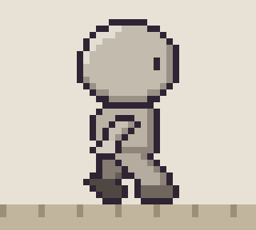
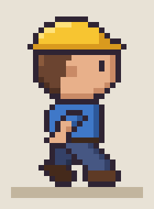
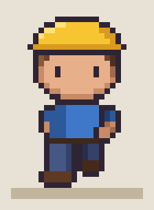
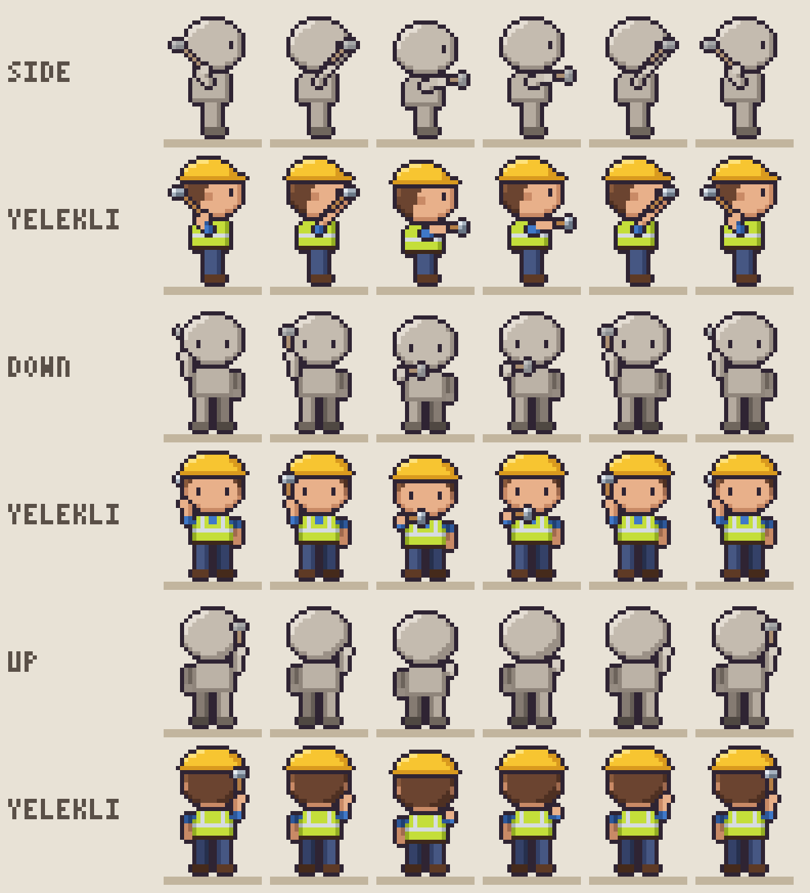
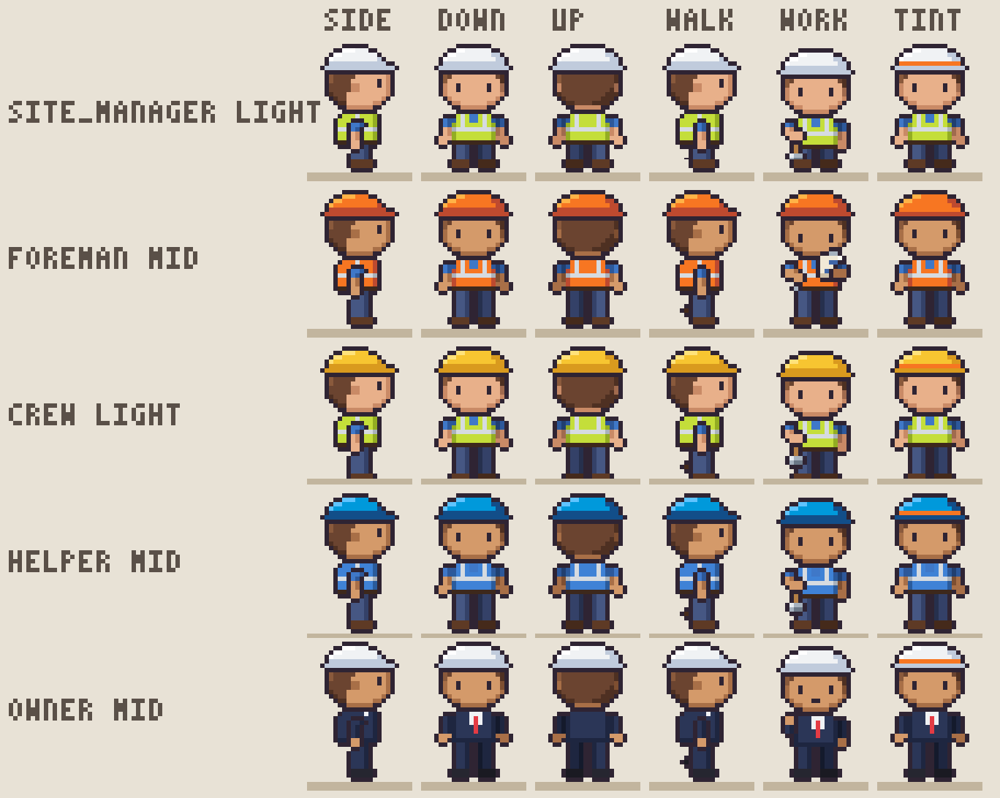
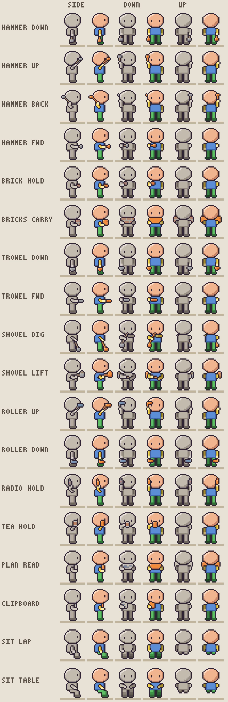
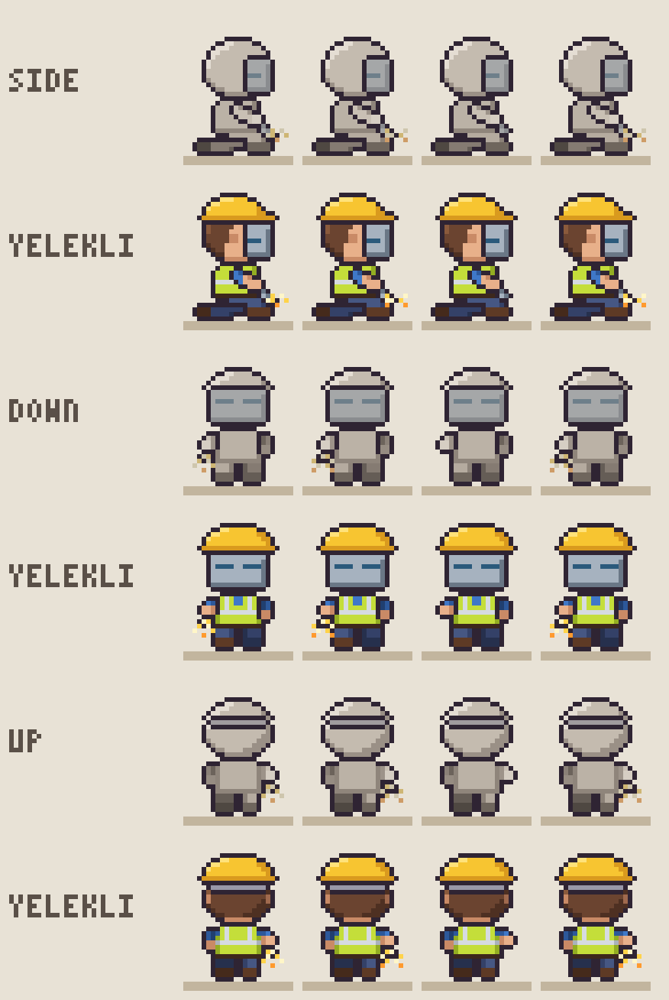
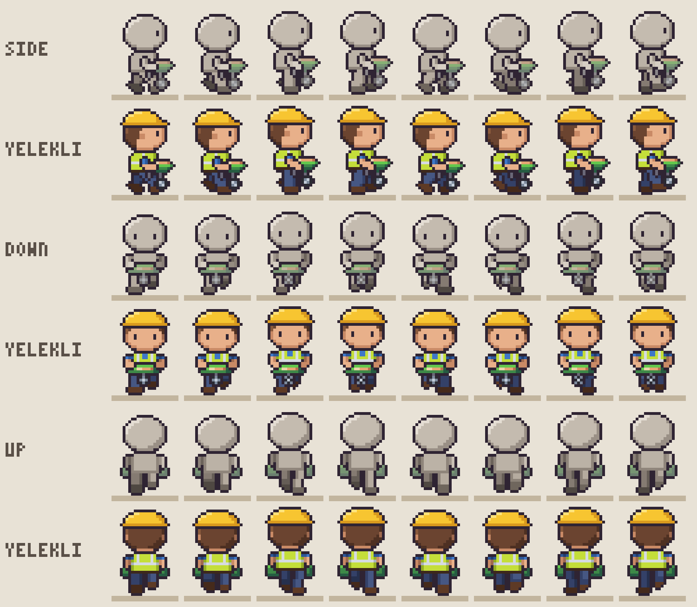

# piksel-iskelet

*piksel-iskelet* is Turkish for "pixel skeleton".

Pixel-art character skeletons. A template's mannequin is animated once; characters are skins that
dress it, so every character inherits the same walk without any frame being redrawn. Project-agnostic:
Siteyard (a pixel construction site that shows coding agents at work) is the first consumer, other games
pick a template or add one.

| Mannequin | Skin `isci`, side | Skin `isci`, front |
| :---: | :---: | :---: |
|  |  |  |

One animation, every skin: the mannequin and the vest skin (`yelekli`) on `hammer_wall` in all three facings.



**Status:** early. The template, the skin format and the exporters may still change.

Every pixel of a frame is a letter that names a body part and tone (`H` head, `L`/`K` near/far leg,
`e` outline...) and also remembers its part and UV (`u`, `v` inside that part). A palette turns
letters into colors (the mannequin and the part map are the first two); a skin turns UVs into
materials.

## Templates

| Template | Frame | View | Animations |
| --- | --- | --- | --- |
| `chibi24x32` | 24x32 | 3/4 top-down: side (left = mirrored right), down, up | `walk_side`, `walk_down`, `walk_up` (8 frames, 10 fps, 2 px/frame; front and back are the side walk projected), `idle_side`, `idle_down`, `idle_up` (4 frames, 4 fps); tool work in every facing (`anims.ts`, key-pose tables): `work` (hammer at the hip), `hammer_wall`, `trowel`, `dig`, `paint`, `measure`, `weld` (kneeling, mask, torch, sparks); loaded walks on the walk's own legs and pace: `carry` (brick stack), `push_cart` (wheelbarrow, wheel in two phases), `climb` (a ladder from behind, in place; every facing name draws the back view, `Anim.facing`) |

## Skins

A skin (`src/skin/skins/*.ts`) names materials (4-tone ramps) and places them:

- head and torso: one text grid per facing, aligned with that facing's mannequin grid;
- arm and leg: one strip shared by all facings, row = v along the limb (shoulder to hand, hip to foot);
- overlays for what leaves the silhouette (hair volume, hats), anchored to a part.

Tones come from the mannequin letters, so light and shade stay consistent across characters. A skin may
also override prop materials (`props: { paper: ... }`); otherwise props use their default ramps.
`skins/roles.ts` builds Siteyard's eight roles in three skin tones from the vest skin (`roleSkin(role, tone)`,
`loadSkin("foreman:mid")`); the hat band is its own material (`band`) for a runtime tint.
`skins/siteyard.ts` is symbolic: its ramps hold Siteyard palette letters (and the symbols Siteyard substitutes
per role and skin tone), and `dressSymbols(sprite, skin, facing)` turns a frame into those letter rows.



## Poses, props and sitting

Besides the walk and idle tables, a facing draws any general pose (`src/templates/chibi24x32/pose.ts`):

- an arm is posed by a hand target in body space, `{ fwd, up, out }` px from the shoulder, solved as a
  two-bone chain in 3D and projected by each facing (the side view keeps forward/up, the front and back
  views keep out/up and what points at the camera shortens). `HANDS` holds the common targets (hang,
  chest, face, reach, raise, lap, table); the same target serves every facing;
- a stance: standing on the walk's leg tables, or `sit` with the hips on `SEAT_HIP` (row 25, Siteyard's
  seat row) and the upper body down `SEAT_DY` rows;
- props (`src/props.ts`, drawings in `src/templates/chibi24x32/props.ts`): hand-drawn views per facing and
  orientation (`down` hanging, `up` raised, `fwd`/`flat`, `hold`), pinned by a grip cell to a hand; two
  grips pose the second arm; near-hand props draw in front of the body, far-hand behind, and from behind
  whatever is held in front hides behind the body. Prop pixels carry `prop:<name>` and their grid UV, and
  letters that name a material and tone, so skins color them.



| `weld` (kneeling, mask, torch, sparks) | `push_cart` (wheel in two phases) |
| :---: | :---: |
|  |  |

`poseFrame(facing, pose)` renders one pose; an animation is a list of poses. The review poses (every prop
in every facing, the seated poses) live in `showcase.ts`; `node --test` checks that the walk and idle frames
are unchanged (hash), that nothing reaching ahead shows on the back, and that the poses dress without magenta.

## Tools

```sh
node tools/preview.ts out                       # mannequin: GIF (x8, scrolling ground), strip (x6), 1x sheet
node tools/skin-preview.ts isci                 # a skin on every animation -> out/skins/isci/
node tools/aseprite-export.ts isci              # .aseprite with walk_right/left, idle_right/left... tags
node tools/grids.ts                             # mannequin head/torso grids per facing + limb UV ranges (for skins)
node tools/compare-siteyard.ts ../siteyard      # Siteyard v1 walk next to the skeleton's walk
node tools/props-preview.ts isci                # props in every facing + seated poses, mannequin and skin -> out/props/
node tools/anim-sheet.ts yelekli                # tool animations: frame sheets per animation + one GIF of all -> out/anims/
node tools/roles-preview.ts                     # the Siteyard roles x skin tones (skins/roles.ts), band tint demo -> out/roles/
node tools/siteyard-export.ts ../siteyard        # every animation as Siteyard letter grids -> <root>/src/theme/construction/sprites/skeleton.ts (or a .ts path; --json too)
npm test                                        # node --test test/*.test.ts: walk/idle lock, back-view hiding, no magenta, Siteyard letters
```

The ground ticks in the mannequin walk GIF scroll at the walk speed: a planted foot must stay on its tick.

Node 24+, no dependencies. `aseprite-export` needs Aseprite (Steam path or `ASEPRITE=<exe>`).
`compare-siteyard` and `siteyard-export` need a local Siteyard checkout.

The images in `docs/images/` come from `preview`, `skin-preview isci`, `anim-sheet yelekli`, `props-preview isci`
and `roles-preview` (the roles image is a cropped selection of its rows).

## License

MIT, see [LICENSE](LICENSE). Only original characters are in this repository.
